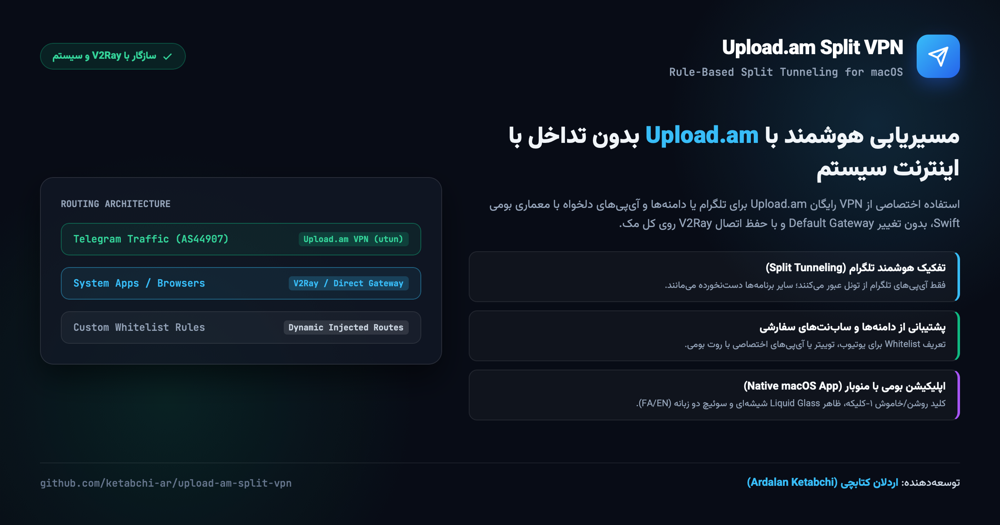

# ابزار و داشبورد مسیریابی تفکیکی Upload.am برای مک (macOS)

<p align="center">
  <a href="https://devsponsors.github.io"></a>
  <a href="https://devsponsors.github.io"></a>
  <a href="https://devsponsors.github.io"></a>
  <a href="https://devsponsors.github.io/mediakit.html"></a>
</p>

<p align="center">
  <a href="README.md">English</a> • <b>راهنمای فارسی</b>
</p>

<p align="center">
  
</p>

یک اپلیکیشن بومی سبک (Swift) همراه با منوبار مک و اسکریپت سفارشی‌سازی قوانین روت OpenVPN بر پایه سرویس رایگان **Upload.am**.

هدف اصلی این پروژه: **فعال‌سازی VPN اختصاصی فقط برای تلگرام یا سایت‌های دلخواه، بدون تغییر گیت‌وی پیش‌فرض سیستم و بدون تداخل با سایر برنامه‌ها یا ابزارهای فیلترشکن دیگر مثل V2Ray / Clash**.

---

## قابلیت‌های کلیدی

- **تفکیک هوشمند ترافیک (Split-Tunneling پیش‌فرض):** با بهره‌گیری از `route-nopull`، اینترنت اصلی سیستم و تنظیمات V2Ray کاملاً دست‌نخورده باقی می‌ماند و فقط بسته‌های تلگرام از تونل عبور می‌کنند.
- **۴ حالت مسیریابی ترافیک (Routing Modes):**
  1. **فقط تلگرام:** روت مستقیم روی کل رنج‌های آی‌پی سرورهای تلگرام (`149.154.160.0/20`، `91.108.0.0/16` و...).
  2. **تمام اینترنت (Full VPN):** عبور تمام ترافیک سیستم از سرور.
  3. **لیست سفید دلخواه (Custom Whitelist):** عبور فقط دامنه‌ها یا آی‌پی‌های دلخواه شما (مثلاً `twitter.com`, `youtube.com`, `1.1.1.1/32`).
  4. **حالت استثنا (Exclude):** عبور همه ترافیک از VPN به جز آی‌پی‌های مشخص‌شده (از طریق `net_gateway`).
- **اپلیکیشن گرافیکی و منوبار macOS:**
  - توسعه‌یافته با زبان Swift بومی اپل و ظاهر شیشه‌ای مدرن (`NSVisualEffectView`).
  - دکمه ۱-کلیکه روشن/خاموش همراه با درخواست بومی Touch ID / پسورد ادمین سیستم.
  - آیکون وضعیت در منوبار بالای مک (⚪ قطع / 🟢 متصل).
  - نمایش زنده لاگ‌های سرور و وضعیت پینگ بدون نیاز به ترمینال.
  - قابلیت سوئیچ آنی زبان فارسی و انگلیسی.
- **بدون وابستگی اضافه:** اسکریپت‌ها بر پایه کتابخانه‌های استاندارد پایتون (Stdlib) کار می‌کنند.

---

## ۱. نحوه ساخت اکانت رایگان و دریافت توکن API

سرویس Upload.am فضای ذخیره‌سازی ابری همراه با پروفایل اختصاصی OpenVPN رایگان در اختیار کاربران قرار می‌دهد.

۱. **ثبت‌نام در سایت:**  
از طریق لینک دعوت زیر ثبت‌نام کنید تا پلن رایگان فعال شود:  
👉 **[https://upload.am/en/register?ref=zzc77xsprl](https://upload.am/en/register?ref=zzc77xsprl)**

۲. **دریافت توکن API:**  
- وارد حساب کاربری شده و به بخش **تنظیمات (Settings)** و سپس **API** بروید (آدرس `/cabinet/api`).
- یک توکن جدید بسازید و آن را کپی کنید (فرمت: `...ua_live_`).

۳. **دانلود فایل کانفیگ OpenVPN:**  
با اجرای اسکریپت موجود در پروژه:
```bash
./scripts/fetch_profile.sh "ua_live_YOUR_TOKEN" ~/upload-am-vpn.ovpn
```
یا با یک دستور ساده `curl`:
```bash
curl -sSL -H "Authorization: Bearer ua_live_YOUR_TOKEN" \
     -H "Accept: application/json" \
     "https://upload.am/api/v1/vpn/profile" > ~/upload-am-vpn.ovpn
```

---

## ۲. نصب و اجرای سریع (macOS)

مخزن را کلون کرده و اسکریپت نصب خودکار را اجرا کنید:

```bash
git clone https://github.com/ketabchi-ar/upload-am-split-vpn.git
cd upload-am-split-vpn
./install.sh
```

این اسکریپت وجود Homebrew و OpenVPN را بررسی کرده، برنامه بومی را کامپایل می‌کند و آن را در پوشه `~/Applications/UploadAmVPN.app` قرار می‌دهد.

برای اجرا:
```bash
open ~/Applications/UploadAmVPN.app
```

---

## ۳. استفاده مستقیم از اسکریپت ترمینال (CLI)

اگر ترجیح می‌دهید بدون رابط کاربری گرافیکی یا با نرم‌افزارهای کلاینت OpenVPN (مثل Tunnelblick یا OpenVPN Connect) کار کنید:

### حالت اول: فقط تلگرام (بدون تداخل با V2Ray)
```bash
python3 scripts/generate_config.py \
  -i ~/upload-am-vpn.ovpn \
  -o ~/telegram-vpn.ovpn \
  -m telegram
```

اجرا در ترمینال:
```bash
sudo openvpn --config ~/telegram-vpn.ovpn
```

### حالت دوم: لیست سفید دامنه‌ها و آی‌پی‌های دلخواه
```bash
python3 scripts/generate_config.py \
  -i ~/upload-am-vpn.ovpn \
  -o ~/custom-vpn.ovpn \
  -m custom \
  -t twitter.com youtube.com 1.1.1.1/32
```

### حالت سوم: همه اینترنت به جز موارد خاص
```bash
python3 scripts/generate_config.py \
  -i ~/upload-am-vpn.ovpn \
  -o ~/exclude-vpn.ovpn \
  -m exclude \
  -t 192.168.1.0/24 10.0.0.0/8
```

---

## خاموش کردن و قطع اتصال

- **از داخل برنامه:** کلیک روی دکمه **خاموش کردن (Disconnect)**.
- **از طریق منوبار مک:** کلیک روی آیکون در منوبار بالای صفحه و انتخاب **Disconnect**.
- **از طریق ترمینال:**
  ```bash
  sudo killall openvpn
  ```

---

## دیاگرام معماری شبکه

```
                 [ ترافیک شبکه سیستم ]
                           │
       ┌───────────────────┴───────────────────┐
       │                                       │
  تلگرام یا دامنه‌های مشخص‌شده             سایر برنامه‌ها و مرورگرها
       │                                       │
       ▼                                       ▼
 [ تونل Upload.am VPN ]                 [ اینترنت عادی یا V2Ray ]
 (172.252.236.84:443 TCP)                     (کاملاً دست‌نخورده)
```

---

## لایسنس

این پروژه تحت مجوز [MIT](LICENSE) منتشر شده است.
